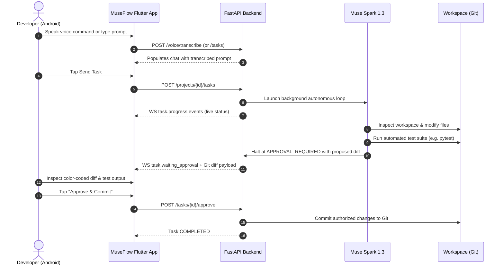

# MuseFlow — Product Vision, Architecture, and Implementation Status

**Status Date:** 29 October 2026  
**Repository:** [SajivJess/Jess-IDE](https://github.com/SajivJess/Jess-IDE)  
**Product:** **MuseFlow** (Mobile AI Pair Programming & Coding IDE)  
**Target Event:** Meta Global AI Developer Hackathon  

---

## 1. Executive Summary

**MuseFlow** is a mobile-first developer environment that puts the power of autonomous AI coding agents directly into your pocket. While traditional AI coding assistants tether developers to a desktop screen, MuseFlow enables developers to prompt, follow, verify, and approve real code changes on a remote or local development machine entirely from a native Android smartphone.

The system combines:
1. **A Native Android App (Flutter):** Custom dark-mode IDE interface featuring conversational chat, push-to-talk voice input, live WebSocket streaming, visual UI design mockups, and interactive Git diff reviews with per-file stats.
2. **A Production FastAPI Backend (Python 3.10+):** Asynchronous orchestration engine managing isolated project workspaces, running automated verification commands, coordinating WebSockets, and securing credentials.
3. **The Three-Model Meta Strategy:**
   - **Muse Spark 1.3** (`muse-spark-1.3`): Primary autonomous coding agent for multi-turn file inspection, code editing, reasoning, and test execution.
   - **Muse Voice Transcribe 1.0** (`muse-voice-transcribe-1.0`): Server-side conversational voice transcription with format validation and size ceilings.
   - **Muse Image 1.0** (`muse-image-1.0`): Visual interface design mockup generator with one-tap "Code This Design" dispatch.

---

## 2. The Core End-to-End Workflow

The complete end-to-end loop is fully functional in the codebase:

---

## 3. Implemented Capabilities vs. Simulation Modes

To ensure predictable evaluation and bulletproof offline testing, the system provides transparent mode delineation:

| Capability | Live Provider Mode (`MODEL_API_KEY` set) | Offline Simulation Mode (No Key Set) | Automated Test Status |
| :--- | :--- | :--- | :--- |
| **Agentic Coding** | `muse-spark-1.3` calls Meta Model API; reasons over code; runs real tests on workspace. | Deterministic agent loop; inspects repo; generates mock diff; validates approval cycle. | **Verified** (40+ task tests passing) |
| **Voice Transcription** | Submits binary audio to `muse-voice-transcribe-1.0`; transcribes English/Tamil speech. | Returns clearly labelled `[Simulated Voice Note]` transcript; never confused with real audio. | **Verified** (Size & format tests passing) |
| **UI Design Mockups** | Generates visual mockup images via `muse-image-1.0`; streams preview URI to client. | Returns high-contrast `[Simulated Mockup]` card preview (`simulated_ui_mockup.png`). | **Verified** (Mockup generation passing) |
| **Git Diff Review** | Real `git diff` generated from workspace Git repository; unified diff chunk viewer. | Real `git diff` generated from seeded workspace; identical mobile review interface. | **Verified** (Diff viewer & parsing passing) |

---

## 4. Hardened Reliability & Security Boundary

In response to comprehensive repository audits, the following security guarantees are strictly enforced:

1. **Bearer Token Logging Eliminated:** `TaskStreamService` and WebSocket clients omit authorization query parameters from device and diagnostic logs.
2. **Production Signing Secret Enforcement:** The backend performs startup validation rejecting short (< 32 char) or default placeholder keys in `production` and `staging`.
3. **Android Cleartext Restriction:** `network_security_config.xml` explicitly disallows cleartext HTTP across public networks, restricting unencrypted traffic exclusively to `127.0.0.1`, `localhost`, and `10.0.2.2`. The in-app Settings screen warns users if an insecure HTTP endpoint is manually selected.
4. **Sanitized Public Responses:** Uncaught service errors return generic client-facing HTTP 502/504 responses without leaking stack traces or internal provider payloads.
5. **Payload Ceilings:** Audio uploads enforce a strict 15 MB limit and whitelist allowed audio container formats (`.m4a`, `.wav`, `.mp3`, `.webm`, `.ogg`, `.aac`).
6. **Non-Destructive Demo Seeding:** `python scripts/setup_server.py` safeguards existing workspace code by default, requiring an explicit `--reset` flag for destructive resets.

---

## 5. Automated Verification Summary

- **Backend Pytest Suite:** 97 tests passing (100% pass rate) across authentication, workspaces, task loops, git reviews, and Meta model integrations.
- **Flutter Client Suite:** 30 tests passing (100% pass rate) across audio checks, WebSocket sequence reconciliation, chat components, and navigation shells.
