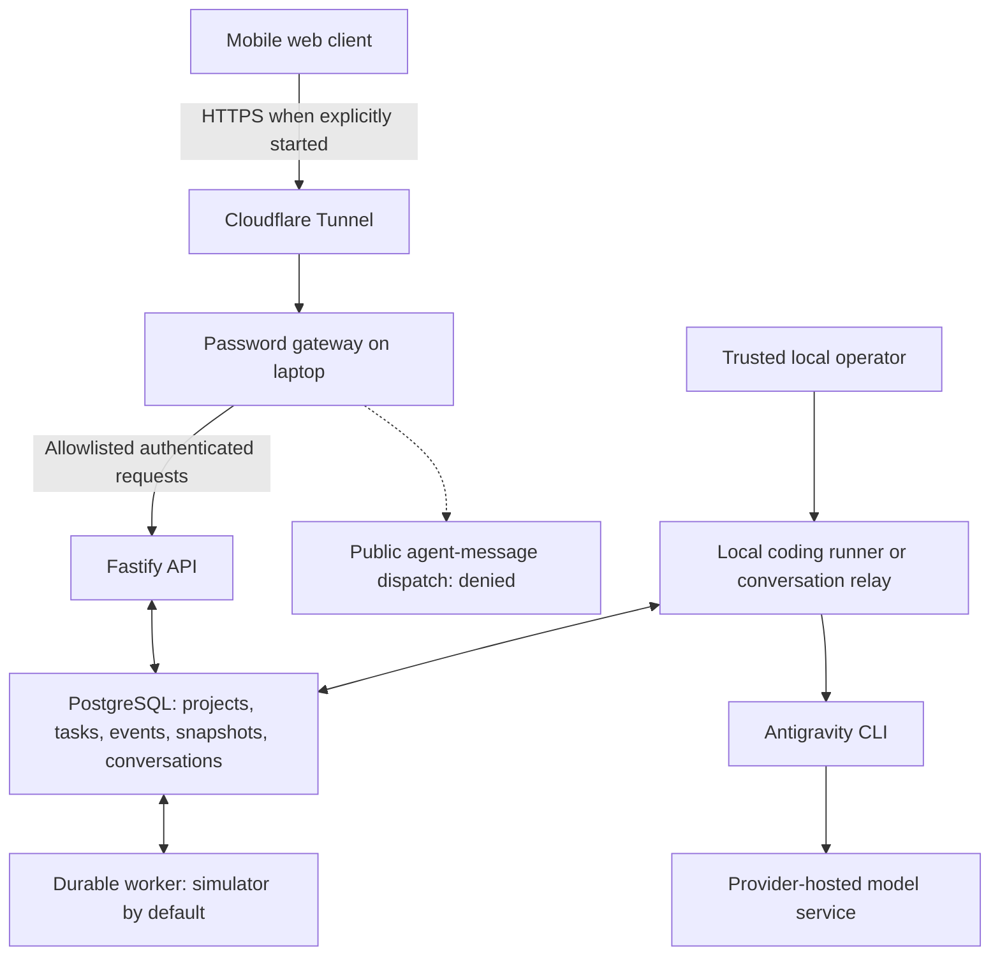

# Jess Ide Dev — vision, goals, progress and roadmap

**Status date:** 21 October 2026

**Repository:** [SajivJess/cloudaiagent](https://github.com/SajivJess/cloudaiagent)

**Implementation checkpoint assessed:** [`255d346`](https://github.com/SajivJess/cloudaiagent/commit/255d346a63d24844cfed8233482708d01fb170ca) on `main`

**Execution host:** the owner's Windows laptop in Nagercoil

**Primary client:** a phone used remotely, including from Chennai

This document is the current product brief. Older implementation reports describe their own milestones and may still say that work was uncommitted or that Chat was the initial screen. The source checkpoint above has been pushed, Home is the initial screen, and Home is the first button in the workspace navigation bar.

## 1. What we are building

Jess Ide Dev is a mobile-first development workspace for working with coding agents on a personal development computer. The phone provides a focused interface for choosing a project, continuing a conversation, following work and reviewing changes. The laptop hosts the application, project data and development tools.

The intended experience is:

1. Sign in from the phone and choose or create a project.
2. Continue the appropriate agent conversation for that project.
3. Send a coding instruction to the laptop.
4. Let the agent inspect or modify an assigned, isolated workspace.
5. Receive the actual response, execution status, changed files, checks and diff.
6. Review the exact result and separately approve any commit or push.
7. Preserve a portable project record so work can continue in another supported session, account or IDE.

**Steps 3–6 are not yet a complete public, end-to-end workflow.** The interface and local CLI integration exist, but secure remote dispatch, enforced execution isolation, automatic artifact handoff and in-app Git approvals still need implementation.

Jess should provide a useful conversation and review experience on a phone. Desktop screen streaming is not the primary product interface. A native Android client is a later phase, after the mobile web workflow and API contracts are reliable.

## 2. Our goal and the decisions behind it

### The immediate goal

Deliver one trustworthy internal workflow: send a task from the phone, execute it through Antigravity in a restricted laptop workspace, receive the real reply and artifacts, and review the result before authorizing Git operations.

### The longer-term goal

Provide one coherent interface across multiple projects and, eventually, several supported IDEs or coding agents. Each integration should use the provider's supported input, output and session mechanisms. Jess owns project organization, delivery metadata, review and portable context; the selected agent owns its native reasoning and conversation context.

### Decisions already made

| Decision | Meaning for implementation |
| --- | --- |
| Mobile web first | Improve and validate the responsive application before maintaining a separate Android app. |
| Antigravity first | Antigravity is the only real-agent integration currently implemented. Other integrations are future work. |
| Laptop execution | Keep the backend, database, workspaces and command execution on the owner's laptop; a paid cloud VM is not required for the current setup. |
| E-drive project storage | Keep managed source, tools, dependencies, caches, temporary files, exports and backups on E:. |
| Reuse the existing backend | Extend Fastify, PostgreSQL, the worker and the gateway rather than creating another task or conversation engine. |
| Preserve native context | Resume the exact supported CLI session when available; do not start an unrelated conversation for each follow-up. |
| Portable context | Keep durable project notes, handoff information and transcripts independently of the CLI's native session. |
| Review before Git writes | Committing and pushing are distinct actions requiring explicit authorization. No automatic merge. |
| Truthful status | Recorded history, simulated work, live execution, process exit, test results and observed changes must remain distinguishable. |

Local-first execution does **not** mean that the model runs entirely on the laptop. Antigravity still uses its provider's remote model service. We have not built an on-device LLM or removed that provider dependency.

The E-drive requirement also needs a precise boundary: Jess's managed paths are on E:, but relocating an application profile does not relocate Windows itself or necessarily Windows Credential Manager. Existing authentication notes identify that limitation. A strict guarantee that agent credentials and all operating-system writes avoid C: has not been established.

## 3. Where the project stands today

**The application foundation and mobile interface are implemented. Local real-agent execution and native session continuity have been demonstrated. Secure public phone-to-agent execution is still the main unfinished milestone.**

| Area | Status on 21 October | Practical meaning |
| --- | --- | --- |
| Fastify API, PostgreSQL and durable task worker | Implemented and tested | Owned projects, queued work, events, leases, recovery and cancellation exist. |
| Default task execution | Simulated | The default fake adapter does not edit a repository or execute project tests. |
| Local Antigravity coding-task runner | Implemented; historically live-verified | A trusted local task made a real file change and returned an actual diff. It is not an OS sandbox. |
| Local session-aware conversation relay | Implemented; historically live-verified | Actual replies, exact native-session resumption and portable transcript generation were demonstrated. |
| Public remote agent sending | Disabled | Both gateway and API reject chat dispatch. Enabling a button would not complete this workflow. |
| Mobile Home and project launcher | Implemented and tested | Saved profile greeting, project creation, recent work, search, metadata and project reopening. |
| Chat UI and conversation management | Implemented and tested | Real recorded messages, Markdown/code rendering, search, rename, archive/restore, export and draft controls. |
| Remote review editor | Implemented and tested | Browse and edit owned review snapshots with conflict detection and per-file diffs. |
| Live checkout editing from the phone | Not implemented | Review snapshots are not an unrestricted host filesystem browser. |
| Chat-linked execution artifacts | Incomplete | Actual task output is not yet automatically bound to the chat's review snapshot. |
| OS-enforced agent isolation | Not delivered | Designs and local investigation exist; no validated execution boundary is enabled. |
| In-app Git approvals | Design only | There are no commit, push or merge approval endpoints. |
| HTTPS public portal | Previously verified; currently stopped | A temporary Cloudflare tunnel works when explicitly started. There is no always-on address. |
| Android application | Deferred | No native Android application or APK has been produced. |
| Attachments, voice and additional IDEs | Pending | Research and product direction exist; these are not working integrations. |

The laptop's public tunnel, portal, API, worker and database are currently stopped at the owner's request. Temporary local services were used for validation and then stopped. No service needs to be started to read this document.

## 4. What has been completed

### Backend and task lifecycle

The TypeScript/Fastify API provides project and task creation, owned history, task status/results, cancellation and durable ordered events. PostgreSQL stores task state and jobs transactionally. A separate worker claims jobs using leases, fencing tokens and heartbeats.

Idempotency keys protect repeated task submissions. Worker recovery, lease expiry, competing workers, cancellation and disconnected clients have regression coverage. The API supports event replay and a loopback SSE endpoint. The public web portal currently uses authenticated polling/replay rather than an open SSE connection.

This infrastructure is not a guarantee of exactly-once real-world side effects. Safe recovery of an interrupted coding task still requires execution checkpoints and reconciliation before broad remote use.

### Password-protected remote access

A narrow Node gateway serves the frontend and forwards allowlisted requests to the loopback API. It holds backend credentials server-side, fixes the configured owner, checks Host/Origin and uses an HttpOnly, Secure, SameSite session cookie. The session lasts up to eight hours; gateway restart clears its in-memory sessions.

Cloudflare Tunnel has exposed the gateway over HTTPS for phone testing. PostgreSQL and the raw development API are not intended to be exposed directly. The current identity model is a single-owner development setup, not production multi-user authentication.

### Home, navigation and projects

Home opens after sign-in and focuses on starting or resuming work. It includes a saved display name, project creation, actual project cards, Continue working, global project/conversation search, sorting and grid/list views. Project visits and selected conversations are recorded server-side.

Within the workspace, navigation contains **Home, Chat, Projects, Tasks and Files**, with Home first. The dedicated top-header Home shortcut was removed. Home itself remains a focused launcher without a bottom navigation bar. Settings is available contextually.

Creating a project creates application records. Choosing a registered repository does not clone an arbitrary GitHub repository or launch the agent. Handling of partially completed project creation prevents accidental duplicate creation.

### Chat and conversation organization

The responsive Chat screen includes a mobile drawer/desktop sidebar, project selection, title/content search, new conversations, rename, archive/restore and transcript downloads. Metadata changes use revisions and preserve historical turns.

Messages display recorded user text and actual recorded agent replies in order. The safe renderer supports Markdown, highlighted code blocks, tables and copy actions without executing response HTML or automatically loading remote images. The composer grows with multiline input and remains usable in short and narrow browser viewports.

Four prompt shortcuts are implemented: Explain code, Debug a problem, Write tests and Review changes. User messages have copy and reuse actions. Reuse and shortcuts append to the current draft; exceeding its length limit leaves it unchanged.

Drafts and conflicting note edits survive in-page conversation/project/tab switching. They are kept in memory, not browser persistent storage: a full reload or browser termination can lose an unsent draft. The app warns about unsaved work, clears private state on session expiry, and distinguishes browser connectivity, laptop reachability and recorded CLI state.

The latest reliability fix separates background replay from foreground busy state. A delayed replay cannot disable an interactive action or replace a newer action's state. A deterministic browser test holds replay open while exercising Archive, search, restore and draft preservation.

### Local Antigravity integration

There are two distinct local paths:

- The **coding-task runner** uses a task-specific clone/branch, invokes the CLI for trusted local work, captures actual changes and runs host-controlled checks. It has runtime/output bounds and process/cancellation handling.
- The **conversation relay** accepts an explicitly supplied local message batch, uses structured CLI input/output, preserves the exact native conversation ID and journals genuine final replies and bounded progress metadata.

On 17 October, a real local coding task created a small documentation file and returned its actual diff. On 18 October, three conversation turns demonstrated continuity: two in one process and a third in a new process resuming the same native session and recalling an earlier marker.

Those are dated, specific demonstrations. They do not prove unrestricted coding reliability, an always-connected native process or secure public execution. The relay does not automatically watch the phone for new messages or attach to an arbitrary existing IDE terminal.

### Portable project context

PostgreSQL stores the durable conversation/event journal. Markdown is a portable projection of that journal, with separate project summary and handoff notes:

```text
.jess-ide/
  PROJECT_CONTEXT.md
  conversations/conversation-<conversation UUID>.md
  handoffs/latest-handoff.md
```

Native session context and portable context are different. Normal continuation uses the native session. A new supported session can receive the relevant summary/handoff; Jess does not inject all historical messages into every prompt or promise that native internal state transfers between accounts and IDEs.

The local relay records stable message IDs and delivery outcomes. An interrupted delivery can be marked uncertain and is not automatically resent. Project notes are revision checked. Export filtering removes known credentials and common secret patterns, but is not a universal guarantee that arbitrary prose contains no secrets.

### Registered repositories and review snapshots

A trusted local registration tool reads an explicitly permitted committed Git revision and imports bounded, reviewed content. Public HTTP clients cannot provide arbitrary host paths or run Git through these APIs.

The Files interface can create a review snapshot for a finished task, list directories, read existing text files, save with version/hash checks and display an actual per-file diff against the immutable registered base. Path policies, ownership checks, protected-path exclusions, size limits and concurrency tests enforce the implemented snapshot boundary.

CodeMirror provides focused text editing, syntax highlighting, line numbers, find/replace and undo/redo. Conflicting saves preserve the user's draft. Unsupported binary/link content is not presented as editable text.

**A review snapshot is the registered base plus manual snapshot edits. It is not automatically the agent's task output or a live checkout.** Checks recorded for an earlier task do not validate later manual snapshot edits.

### Source publication, backups and this chat

The latest application source was committed and pushed to GitHub `main` as `255d346`, covering 63 changed files. GitHub was checked against the local commit and the working tree was clean afterward.

Source checkpoints and some database backups were created on E: during development. These are manual recovery assets; automatic scheduled backups and a fully rehearsed recovery system are not delivered.

A separate private export of this Codex chat was created on 21 October: 226 visible user/assistant messages and all three uploaded screenshots, through that export's cutoff. Markdown, JSON, JSONL and a verified ZIP are stored outside the repository. It is a snapshot, not an automatically updating export of later messages. It contains original login information and must not be treated as a publishable project document.

## 5. How the current system fits together



The future isolated execution broker is not shown as a working connection. It must complete the missing boundary between authenticated phone requests, controlled agent execution and verified review artifacts.

### Storage and source boundaries

| Location | Purpose | Stored in GitHub? |
| --- | --- | --- |
| `E:\cloudaiagent` | Application source, migrations, tests and documentation | Tracked source is pushed. |
| `E:\cloudaiagent\node_modules` | Installed project dependencies | No; reproduce from the lockfile. |
| `E:\cloudaiagent\dist` | Generated application/editor bundles | No; reproduce with the build. |
| `E:\cloudaiagent\.env` and `.local` | Local configuration, credentials, logs, reports and process metadata | No. |
| `E:\tools` | Node, Git, PostgreSQL, CLI, tunnel binary and browser tooling | No. |
| `E:\local-data\jess\pgdata` | Application and test PostgreSQL storage | No. |
| `E:\local-data\jess\workspaces` | Configured local task clones/artifacts | No. |
| `E:\local-data\jess\contexts` | Portable project Markdown projections | No automatic source-repository commit. |
| `E:\local-data\antigravity-home` | Configured CLI profile and local results | No. |
| `E:\local-data\jess\checkpoints` | Development checkpoints and recovery files | No. |
| `E:\local-data\jess\exports` | Private chat exports | No. |

GitHub is a source checkpoint, not a backup of the complete laptop, live database, credentials or conversation data. Restoring only the repository does not restore the running instance's projects and history.

## 6. What remains to be built, in priority order

### P0 — Enforced execution isolation

Provision and test an OS-level boundary that cannot use the Windows user's unrestricted files or credentials. A clone, CLI tool policy, password portal or successful local task is not sufficient.

The chosen local execution environment needs restricted filesystem access, isolated agent authentication, controlled outbound networking, CPU/RAM/disk/process/time limits, whole-execution cancellation and cleanup after interruption. It must not receive the backend token, database password, portal password or GitHub push credential.

VM/container options and an E-drive local prototype have been investigated. No complete boundary has passed the required host-access, credential, network, resource-exhaustion and malicious-artifact tests. No hosted sandbox service or Daytona integration is part of the working product. The deployment choice must respect the local-host and E-drive requirements.

### P0 — Durable phone-to-Antigravity delivery

Connect authenticated messages to that isolated runner using explicit project, conversation, request and native-session bindings. Persist before dispatch, reject duplicate/mismatched requests, serialize the appropriate native session, retain genuine progress/final results, and make uncertain delivery recoverable without blind re-execution.

Reconnecting the phone must retrieve existing work rather than start a duplicate process. Cancellation must stop the actual execution boundary. Structured partial output can be displayed only when the CLI supports reliable semantics; otherwise the UI should show a working state until the real final response arrives.

Keep the public dispatch gate closed until the isolation and delivery acceptance tests pass.

### P0 — Execution artifacts connected to review

Create a validated result manifest binding each output to its owner, repository, task/attempt, base revision and file hashes. Import allowed changed files into a new review revision, attach the real diff and check outcomes, and link that exact result from Chat and Tasks.

Validate exported paths, modes, types and sizes independently. Keep process completion, agent assertions, observed diffs and executed test outcomes separate. A zero exit code alone must not become a claim that a change is correct or tested.

### P0 — Approval-gated Git operations

Implement a narrow Git broker and approval records tied to the exact reviewed manifest, target branch, action and expected remote state. Any edit, new attempt, expired approval or changed remote head must invalidate the approval.

Commit and push require separate explicit authorization. Credentials remain with the broker; the browser and agent do not receive them. Automatic merges and force pushes are not part of the planned initial workflow.

The source push performed through Codex with the owner's explicit instruction is a development operation. It does not mean that Jess already has these in-app approval endpoints.

### P1 — Reliable daily operation and access

Replace development identity before a production multi-user release. Define account/session lifecycle, authorization, revocation and operational auditing. Add startup/restart recovery, health checks, bounded log retention, backup scheduling and restore drills.

Configure a stable HTTPS address and startup policy when the owner chooses to keep remote access available. Temporary tunnel URLs and a laptop that may sleep are not an always-on service. Do not expose the raw API/database as a shortcut.

### P1 — Richer mobile workflows

Add authenticated, bounded attachment storage, safe previews, clear delivery state and supported CLI context transfer. Add missing file operations only through a defined owned-workspace API. Improve diff navigation and artifact-linked test summaries as those backend contracts become available.

Voice input/output requires an explicit processing choice and real-device validation. It must not silently route speech to an unapproved cloud transcription service. Saved prompt management and stronger draft recovery can follow the current built-in shortcuts.

### P2 — More agent adapters and native Android

Evaluate additional IDEs/agents individually for supported CLI/session behavior, authentication, licensing and isolation compatibility. Keep provider-specific behavior behind adapters and preserve project-level transcripts separately from native state.

Build the Android app when the core workflow is stable, using the same authenticated API and product design. Kotlin/Compose is a proposed direction, not an existing implementation. Phone-local storage and laptop workspace files must remain distinct.

## 7. Frontend reuse strategy

Vercel Chatbot, LibreChat, LobeHub and Open WebUI were assessed as references for composition, conversation organization, interaction polish and document handling. They have different stacks and license conditions. No application code or branding from those four repositories was imported into this milestone.

Jess currently retains browser ES modules, semantic CSS tokens, a locally bundled Markdown renderer/CodeMirror editor and its own API client. A Next.js/React migration would be a separate architectural decision, not a drop-in component replacement. The detailed dated assessment and pinned revisions are in the [frontend feature map](frontend-feature-map.md).

The principle is to reuse suitable components or interaction patterns while keeping one coherent product and one backend. A second LLM conversation engine, another application's authentication store and duplicated task logic are outside the present plan.

## 8. Evidence and validation

| Date | Evidence | What it establishes |
| --- | --- | --- |
| 17 October 2026 | Authenticated local task made a small file change and returned an actual diff; host-controlled checks succeeded | One real local coding-task path worked. This was not a public isolated execution test. |
| 18 October 2026 | Three native conversation turns, including exact-ID resumption in another process | Local native continuity and the relay/journal/export path worked for that probe. |
| 18–19 October 2026 | Mobile Home/Chat/editor milestones and public portal checks | The responsive interface, data APIs and password gateway worked in their tested scope. |
| 21 October 2026 | Type checking, lint and build passed; 57 backend, two gateway and 13 frontend tests passed | The committed foundation passed the local automated checks. |
| 21 October 2026 | Delayed-replay regression passed twice on each form factor; final full browser suite passed 24/24 | Phone-emulated and desktop workflows passed after the polling fix. |
| 21 October 2026 | GitHub `main` matched application commit `255d346`; working tree was clean | Latest application source was successfully pushed. Private runtime data was excluded. |

Browser phone emulation is not a physical Android keyboard, microphone or installation test. The pre-push checks did not make new live model calls or prove OS isolation. Historical local CLI verification must be repeated in the eventual isolated runner environment.

## 9. The next milestone's acceptance criteria

The secure remote workflow should be called complete only when all of these can be demonstrated together:

1. A signed-in phone selects an authorized project and sends a uniquely identified instruction.
2. The request reaches the correct isolated execution and native session.
3. A follow-up uses verified native continuity, without crossing projects or profiles.
4. The phone receives the actual response and truthful execution/error states.
5. Refresh, reconnect and retry retrieve existing state without accidental duplicate work; uncertain delivery is explicit.
6. Timeout, cancellation, runner crash and laptop interruption have verified outcomes and cleanup.
7. Attempts to access unrelated host files, credentials, internal services or unapproved network destinations are denied.
8. Actual changed files, diffs and executed checks are bound to the exact reviewed revision.
9. Explicit approval authorizes only the selected commit or push, and any changed input invalidates it.
10. Conversation/context export works, and a new supported session can use the reviewed handoff without pretending to inherit unavailable native state.

At that point the internal beta can perform its core promise. Additional IDEs, richer attachments and a native app can build on that verified path.

## 10. Supporting documents

- [Backend setup and repository README](../README.md)
- [Mobile web architecture and API contract](mobile-web.md)
- [Home launcher behavior](home-launcher.md)
- [Chat UI implementation and acceptance boundaries](chat-ui-design.md)
- [Native CLI relay and portable context](chat-relay.md)
- [Local coding-task runner and verification](antigravity-cli.md)
- [Review snapshots, execution-isolation design and Git approval proposal](workspace-architecture.md)
- [Frontend reuse assessment and latest polling fix](frontend-feature-map.md)
- [Detailed browser verification history](mobile-web-verification.md)

No password, login code, private transcript or credential belongs in this project brief. The private chat export is intentionally a separate local artifact.
